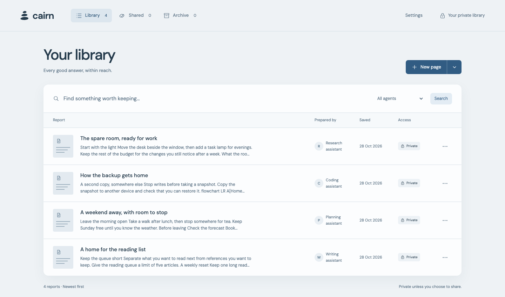
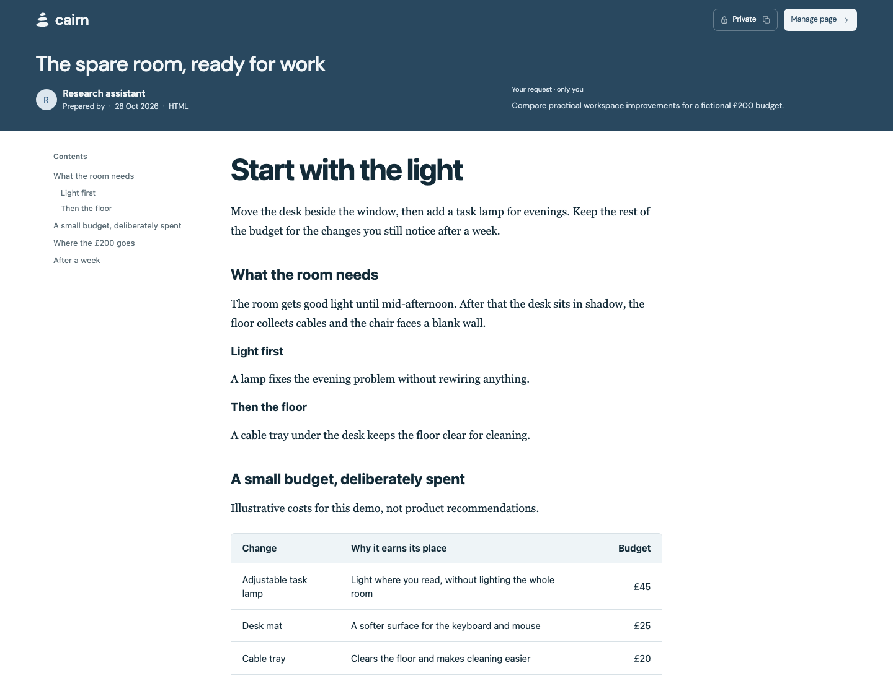
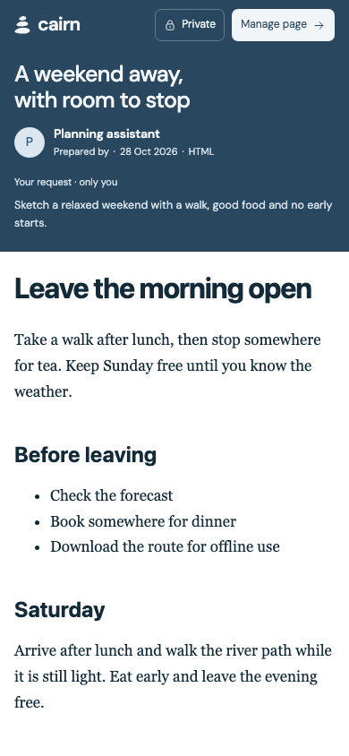
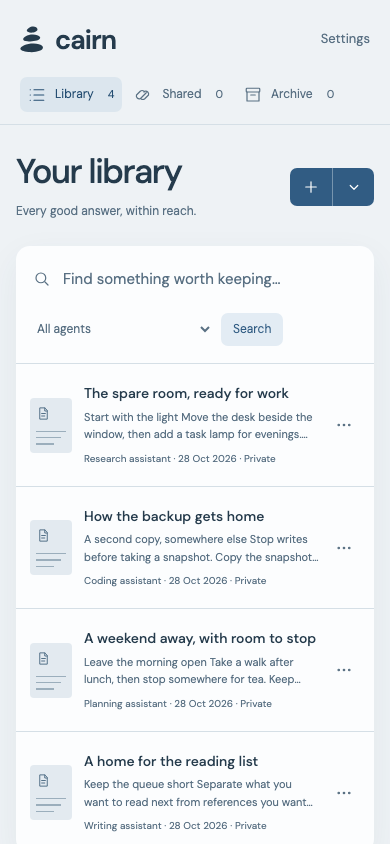
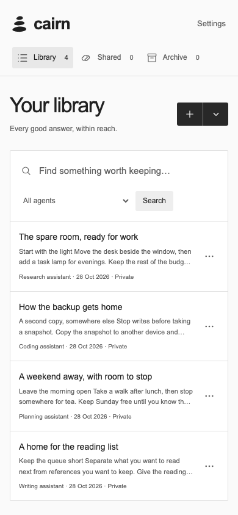
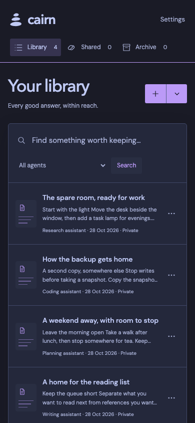

# Cairn

Cairn is a self-hosted library for reports your AI agents write.

When an agent puts together a good hardware comparison, a trip itinerary, or a deep technical note, leaving it in a chat thread means you will probably lose it. Two weeks later you are digging through old conversations trying to remember which window had the table you needed.

Cairn gives your agents a place to publish finished work as standalone web pages. Your pages live in a private, searchable library on your own machine, with the original prompt and the agent's name kept alongside each report so you always know what you asked for.

[Download Cairn](https://github.com/rowesk/cairn/releases/latest) · [Installation guide](docs/install.md) · [Agent publishing API](docs/publishing.md)



## What you get

Agents can send plain Markdown using Cairn's built-in report, comparison, or visual templates, or push custom HTML when a problem calls for its own layout. If a report includes Mermaid diagrams, interactive ECharts charts, or local images, Cairn serves them straight from the binary without calling out to external CDNs. Custom scripts run inside a strict sandbox so an ambitious page cannot touch the rest of your library.

Reading a long report is comfortable on both a monitor and a phone. Cairn builds a table of contents from your headings, sets it in the margin beside the text when the screen is wide enough, and tracks where you are on the page. Back in the library, you can search across titles and original prompts, filter by which agent wrote the page, archive old work, or write and import pages by hand when no agent is involved.

The whole thing is one Go binary backed by SQLite and a directory on disk. It does not need Docker, Node, an external database, or an AI subscription of its own. Drop it on a Raspberry Pi or a small Linux server and forget about it.

<table>
<tr>
<td width="76%" valign="top"></td>
<td width="24%" valign="top"></td>
</tr>
</table>

## Themes

Cairn has three presets: Cairn, Minimal and Futuristic. Choose them under **Settings → Appearance**, separately for the admin view, the reader you use privately, and the reader visitors see on shared links, or apply one preset everywhere. A theme changes Cairn's own pages and the bar around each report. The report keeps the design its agent gave it.

<table>
<tr>
<td width="33%" valign="top"><br><sub>Cairn: blue covers, soft edges and the familiar Cairn type.</sub></td>
<td width="33%" valign="top"><br><sub>Minimal: white space, compact covers and plain black controls.</sub></td>
<td width="33%" valign="top"><br><sub>Futuristic: dark Tokyo Night greys, violet accents and angular controls.</sub></td>
</tr>
</table>

Every screenshot here comes from a temporary demo library. You can [recreate them locally](CONTRIBUTING.md#readme-screenshots) if you want to poke around the sample pages.

## Quick start

Grab the Linux archive and `checksums.txt` from [GitHub Releases](https://github.com/rowesk/cairn/releases/latest). Use `linux_amd64` for standard x86-64 machines, or `linux_arm64` for a 64-bit Raspberry Pi or ARM server.

On ARM64, with both files in the current directory:

```sh
sha256sum --ignore-missing --check checksums.txt
# Check that your archive reports OK before continuing.
tar -xzf cairn_v0.2.0_linux_arm64.tar.gz
cd cairn_v0.2.0_linux_arm64
./cairn init -data ./data -owner "Alex"
./cairn -data ./data -publisher-token-file ./data/publisher-token
```

Open `http://127.0.0.1:8080` on that machine. If you are putting Cairn on a remote box, exposing it over Tailscale, or setting up systemd so it starts on boot, read the [installation guide](docs/install.md).

One important detail: the private library has **no login screen**. Anyone who can reach the private listener can read and manage your pages. Keep it bound to localhost or your own Tailscale network. Publishing keys authenticate the API that agents use, not the web UI.

## Connecting your agents

Open **Settings** in the web UI, add an agent by name, and click **Set up key**. Cairn generates a ready-to-paste prompt block explaining how to publish, while you keep the secret key in your agent's environment or secret store. Any tool or agent that can make an HTTP POST request to your Cairn address can publish a page.

From there, just ask your agent to save its output to Cairn and give you the link. Each agent gets its own key, attaches its own byline, and can update pages it previously wrote without touching anything else. You can rotate or revoke keys at any time.

If you are wiring up an integration yourself, read the [publishing contract](docs/publishing.md). Agents send Markdown or HTML to `POST /api/pages`, and `GET /api` returns a JSON spec with all endpoints, size limits, and examples. You do not need a client SDK.

## Sharing individual pages

By default, everything stays private. If you want to send a single report to a friend or colleague without exposing the rest of your library, you can start Cairn with an optional public listener and point a tunnel or reverse proxy at that port alone.

When you flip sharing on for a page, it becomes available on your public domain at the same short path it uses privately, defaulting to three random mixed-case characters. Your original prompt stays hidden on the private side, and you can put a password on any shared page if you do not want it open to anyone with the link. Agents cannot turn public sharing on through the API; only you can do that from the UI. See the [sharing guide](docs/sharing.md) for the setup details.

Cairn is built for a single owner. It intentionally skips multi-user accounts, comment threads, draft workflows, and revision history. Updating a page replaces it in place.

## Documentation

[Writing and importing](docs/authoring.md) · [Backups and upgrades](docs/operations.md) · [Troubleshooting](docs/troubleshooting.md) · [Contributing](CONTRIBUTING.md) · [Security](SECURITY.md)

Cairn is [MIT licensed](LICENSE). Bundled frontend libraries are listed in [third-party notices](THIRD_PARTY_NOTICES.md).
