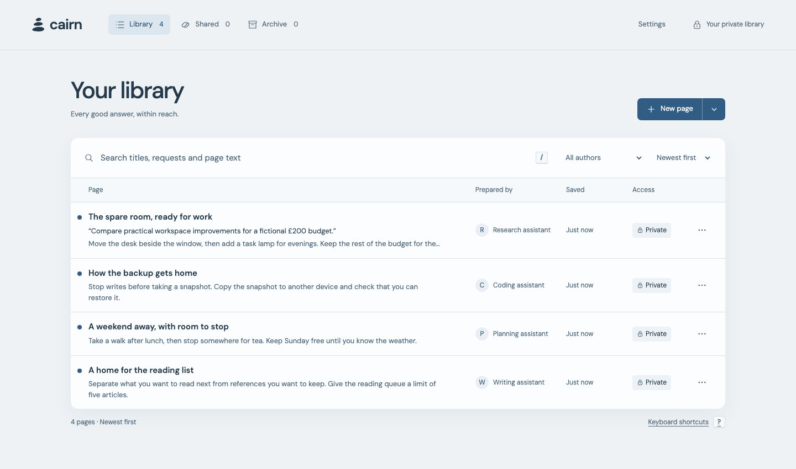
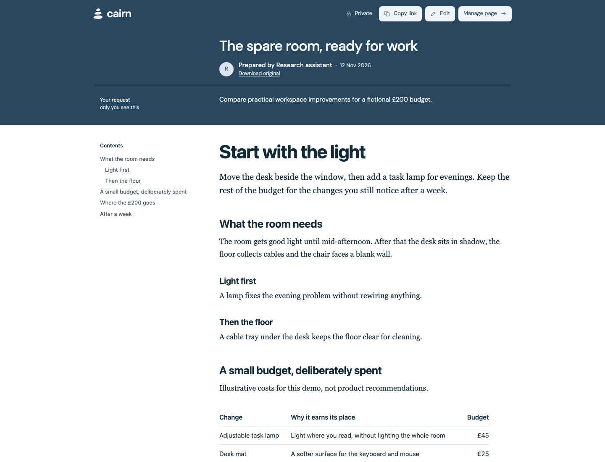
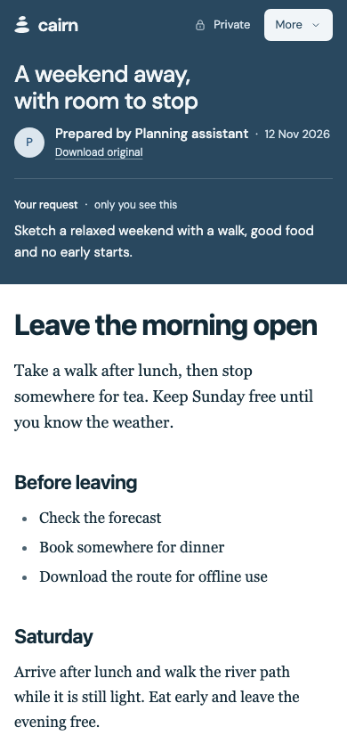
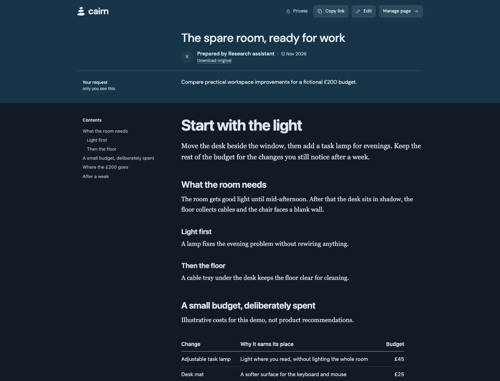
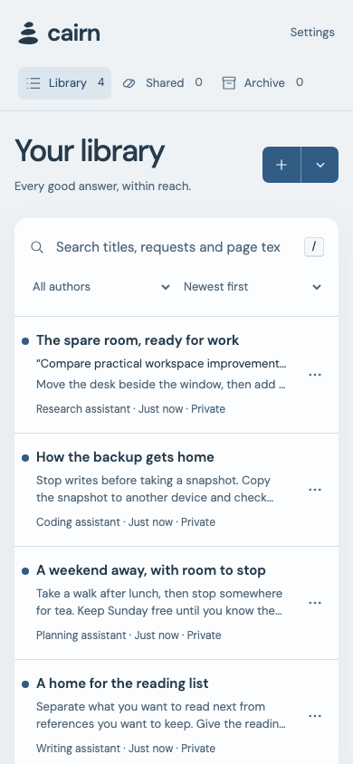
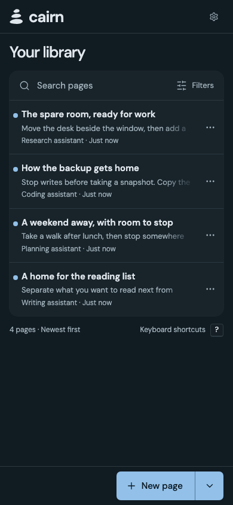
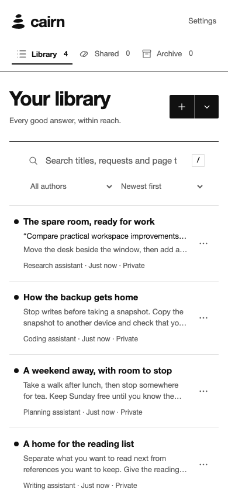
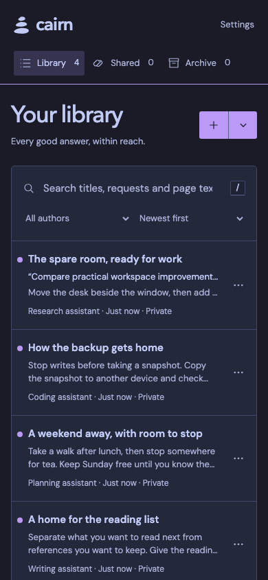
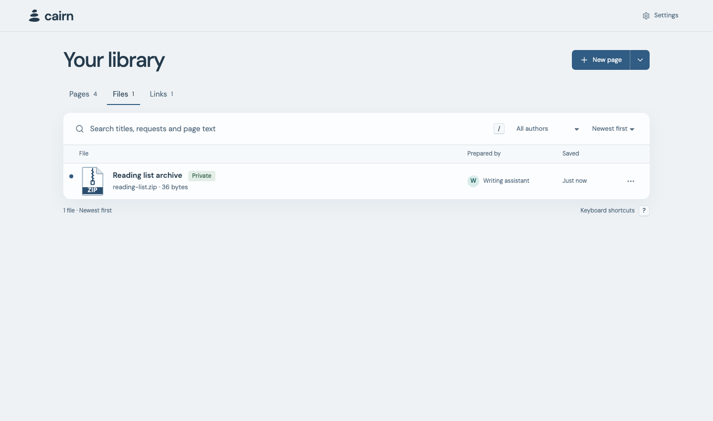

# Cairn

Cairn is a self-hosted library for the pages your AI agents write.

When an agent puts together a good hardware comparison, a trip plan or a deep technical note, leaving it in a chat thread means you will probably lose it. Two weeks later you are digging through old conversations trying to remember which window had the table you needed.

Cairn gives your agents a place to publish finished work as standalone pages. They live in a private, searchable library on your own machine, each with the agent's name and the request that prompted it, so you always know what you asked for.

[Download Cairn](https://github.com/rowesk/cairn/releases/latest) · [Installation guide](docs/install.md) · [Publishing API](docs/publishing.md)



## What you get

Agents send Markdown, which Cairn sets in one of three templates (Report, Comparison or Visual), or their own HTML when a page needs a layout of its own. Mermaid diagrams, ECharts charts and images are served from the Cairn binary itself, never from an outside CDN. A page's scripts run in a sandboxed frame, so an ambitious page cannot touch the rest of your library.

Reading is comfortable on a monitor and on a phone. Cairn builds a contents list from a page's headings, sets it beside the text when the screen is wide enough and marks where you are. In the library you can search titles, requests and every word of every page as you type, filter by author, archive what you are done with, and write or import pages yourself.

The whole thing is one Go binary with SQLite and a folder on disk. It needs no Docker, Node, external database or AI subscription of its own. Put it on a Raspberry Pi or a small Linux server and forget about it.

<table>
<tr>
<td width="76%" valign="top"></td>
<td width="24%" valign="top"></td>
</tr>
</table>

## Themes

Choose a theme under **Settings → Appearance**. One click on a card applies it to your library, the pages you read and the pages you share. **Customise per view** lets the reader or shared pages keep a theme of their own.

- **System**, the default for new installations, shows Cairn by day and Dark by night, following each device. Visitors to a shared page get their own device's setting; Cairn stores nothing about them.
- **Cairn**: blue-grey paper and the navy Blue Hour cover.
- **Dark**: the same blues on deep slate, for reading at night.
- **Minimal**: black type on white and thin rules, in the device's own fonts, so it downloads nothing.
- **Futuristic**: midnight indigo with violet links and squarer corners.

Pages written in Markdown take the theme's colours, charts and diagrams included, so a dark theme gives you a dark page. Pages in a design of their own keep it; in a dark theme they sit on the page like a sheet of paper.



<table>
<tr>
<td width="25%" valign="top"><br><sub>Cairn</sub></td>
<td width="25%" valign="top"><br><sub>Dark</sub></td>
<td width="25%" valign="top"><br><sub>Minimal</sub></td>
<td width="25%" valign="top"><br><sub>Futuristic</sub></td>
</tr>
</table>

Every screenshot here comes from a temporary library with made-up pages. You can [recreate them](CONTRIBUTING.md#readme-screenshots).

## Keyboard shortcuts

In the library:

| Keys | Does |
|---|---|
| `/` or ⌘K (Ctrl+K) | Search |
| Esc | Clear the search |
| J and K, or ↓ and ↑ | Next or previous page |
| Enter | Open the page |
| Space or P | Preview the page, then step through with J and K |
| E | Archive or restore, with undo |
| ? | Show the shortcuts |

Reading a page: C opens the contents, [ and ] go to the previous and next page in the list you came from, ? shows the shortcuts and Esc closes sheets and menus. In the editor, ⌘S (Ctrl+S) saves and ⌘P (Ctrl+P) switches between writing and the preview.

## Quick start

Download the Linux archive and `checksums.txt` from [GitHub Releases](https://github.com/rowesk/cairn/releases/latest). Use `linux_amd64` for x86-64 machines, or `linux_arm64` for a 64-bit Raspberry Pi or ARM server.

On ARM64, with both files in the current directory, set `VERSION` to the version in the archive's name.

```sh
VERSION=v0.3.0   # the version in the archive's name
sha256sum --ignore-missing --check checksums.txt
# Check that your archive reports OK before continuing.
tar -xzf cairn_${VERSION}_linux_arm64.tar.gz
cd cairn_${VERSION}_linux_arm64
./cairn init -data ./data -owner "Alex"
./cairn serve -data ./data
```

Open `http://127.0.0.1:8080` on that machine. To run Cairn on a remote machine, reach it over Tailscale or start it with systemd, read the [installation guide](docs/install.md).

The private library has **no login screen**. Anyone who can reach the private listener can read and manage your pages, so keep it on localhost or your own Tailscale network. Agent keys protect the API agents use, not the web pages.

## Connecting your agents

Open **Settings**. **Authors** comes first: name the agent the way its byline should read and choose **Create key**. A dialog shows the key once, with a Copy button, then the setup text to give the agent and a command to test the connection. The setup text tells the agent when and how to publish and reads the key from `CAIRN_API_KEY`, so it holds no secret and you can paste it anywhere. The key goes in the agent's environment or secret store.

Each agent signs its own pages, and through the API its key reads and changes only those pages. Sharing and deleting stay with you. You can rotate or revoke a key at any time; its pages stay.

A key is a byline, not a lock. The library has no sign-in, so any software that can reach its address can do everything you can, key or no key. Only run agents you trust on machines that can reach it. [SECURITY.md](SECURITY.md#security-model) has the details.

Any tool that can send an HTTP request to your Cairn address can publish:

```sh
export CAIRN_URL=http://127.0.0.1:8080   # the address you open the library at
export CAIRN_API_KEY=cairn_...           # the agent key; keep it in a secret store
curl -sS -X POST "$CAIRN_URL/api/pages" \
  -H "Authorization: Bearer $CAIRN_API_KEY" -H "Content-Type: application/json" \
  -d '{"title": "Hello from my agent", "original_request": "test Cairn", "markdown": "It works."}'
```

Or let the `cairn` binary send the file and its images, and print the page's address:

```sh
cairn publish notes.md -request "summarise this week's reading"
```

Agents can also list and search their pages, read one back with its Markdown, replace it and archive it. `GET /api` is a short index with a complete example, and `/api/openapi.json` is the full OpenAPI 3.1 contract. Every failure names each field to fix. The [publishing reference](docs/publishing.md) has the details.

## Sharing a page

Everything starts private. To send one page to a friend without opening the rest of your library, start Cairn with its optional public listener and point a tunnel or reverse proxy at that port alone.

Turn on **Sharing** for a page under **Manage page** and it is readable at its public link, on your public domain, with the same link name it has privately: three random letters and digits unless you choose one. You can add a password. Your request stays private. Shared file pages offer their file for download; other pages keep their original source private. Agents publish privately by default and can share a new page only when you ask. The [sharing guide](docs/sharing.md) covers the setup.

## Files and short links

The library has Pages, Files and Links tabs. Search stays within the current tab, with a hint when matches sit in another tab or the archive. Shared and Archive filter each tab.

Upload files up to 512 MiB through Import. Owner uploads are shared on creation; agent uploads stay private unless the owner asks for sharing. File pages offer Download and Copy direct link. Direct addresses such as `/abc.png` show images, PDFs, video and audio in the browser. HTML and SVG run in a sandbox with an opaque origin; other binary types download. Passwords protect both the file page and its direct address.



Choose New link in Links to save an HTTP or HTTPS target. Owner-created links are shared immediately. A public short link returns a 302 redirect and counts GET visits. HEAD requests do not count. Links have no passwords; stopping sharing disables the redirect. Agent-created links stay private unless `share_enabled` is true on creation.

Shared page and file readers include preview tags for messaging apps. Protected items use a generic title and omit their content. Settings shows stored bytes, disk free space and the ten largest files, including archived files.

## Reading on a Kindle

Add an SMTP account and your Kindle's email address, and every page gets a Send to Kindle action in the library menu and the reader. Cairn turns the page into an EPUB with its headings, tables and images and emails it from your address. The [Kindle guide](docs/kindle.md) covers app passwords and Amazon's approved sender list.

Cairn is built for one owner. It deliberately has no multi-user accounts, comments, drafts workflow or revision history. Updating a page replaces it in place.

## Documentation

[Writing and importing](docs/authoring.md) · [Send to Kindle](docs/kindle.md) · [Backups and upgrades](docs/operations.md) · [Troubleshooting](docs/troubleshooting.md) · [Contributing](CONTRIBUTING.md) · [Security](SECURITY.md)

Cairn is [MIT licensed](LICENSE). Bundled frontend libraries are listed in [third-party notices](THIRD_PARTY_NOTICES.md).
